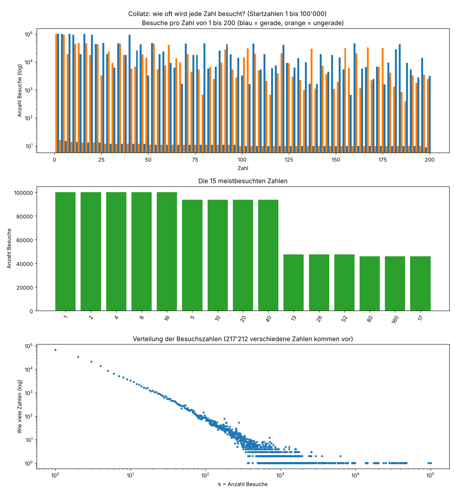

# Collatz-Vermutung

Erforschung der Collatz-Vermutung mit Python und Lean 4.

**Die Vermutung:** Startet man mit einer beliebigen positiven ganzen Zahl und wendet immer wieder

- `n` gerade → `n / 2`
- `n` ungerade → `3n + 1`

an, so landet man irgendwann bei 1. Das ist bis heute **unbewiesen** (ein offenes Problem der Mathematik).
Per Computer wurde es für alle Startzahlen bis über 2^68 geprüft.

## Webseite

Der Ordner [`site/`](site/) ist eine statische Webseite mit allen Erkenntnissen: Bilder, Formeln,
die Lean-Sätze und Python, das direkt im Browser läuft (Pyodide). Sie wird über ein privates
Vercel-Projekt ausgeliefert. Nach Änderungen an Skripten, Beweisen oder Bildern:
`python site/build.py`.

## Skript: Wie oft wird jede Zahl besucht?

`python/collatz_verteilung.py` rechnet die Folgen aller Startzahlen 1 bis N durch und zählt,
in wie vielen Folgen jede Zahl vorkommt. Danach zeigt es drei Diagramme:

1. Besuche pro Zahl für die kleinen Zahlen (blau = gerade, orange = ungerade)
2. Die meistbesuchten Zahlen
3. Wie viele Zahlen genau k-mal besucht werden (log-log)

```bash
cd python
pip install -r requirements.txt
python collatz_verteilung.py 100000                 # öffnet ein Fenster
python collatz_verteilung.py 100000 --bis 500 --top 25
python collatz_verteilung.py 100000 --ausgabe bild.png
python -m pytest                                    # Tests
```

Das Zählen nutzt aus, dass alle Folgen zusammen einen Baum mit der Wurzel 1 bilden. So wird jede Zahl
nur einmal berechnet. 100'000 Startzahlen dauern nur wenige Sekunden.



**Was man sieht:**

- Jede Folge, die nicht schon bei 1, 2, 4 oder 8 startet, läuft über 16 → 8 → 4 → 2 → 1. Die Zahl 8 hat
  nämlich nur einen Vorgänger (16), weil `3n + 1 = 8` keine ganzzahlige Lösung hat. Die 16 selbst wird
  meistens über 5 erreicht (5 → 16), deshalb steht 5 gleich dahinter.
- Die sehr niedrigen Balken im oberen Diagramm gehören zu Vielfachen von 3. Eine solche Zahl kann nie
  aus `3n + 1` entstehen, sie wird also nur von ihren Verdopplungen (m, 2m, 4m, ...) erreicht.
- Die Besuchszahlen folgen ungefähr einem Potenzgesetz: viele Zahlen werden genau einmal besucht,
  ganz wenige sehr oft.

## Weitere Skripte

| Skript | Was es macht |
|---|---|
| `python/stoppzeiten.py` | Gesamtstoppzeiten, Stoppzeiten, Rekordhalter ([Bild](docs/bilder/stoppzeiten.png)) |
| `python/sieb.py` | Restklassen-Sieb: Anteil der Zahlen, die garantiert abfallen ([Bild](docs/bilder/sieb.png)) |
| `python/trajektorien.py` | Einzelne Folgen und die Heuristik "Zufallsweg mit Drift" ([Bild](docs/bilder/trajektorien.png)) |
| `python/zyklen.py` | Zyklensuche, Zyklen bei negativen Zahlen, Kettenbruch von log2(3) |
| `python/verifizieren.py` | Prüft die Vermutung bis N (10 Millionen in ca. 2 Sekunden) |
| `python/baum.py` | Der Collatz-Baum rückwärts von 1; jede Ebene wächst um den Faktor (1+√(7/3))/2 ≈ 1.264 ([Bild](docs/bilder/baum.png)) |
| `python/paritaet.py` | Paritätsvektoren (Satz von Terras) und warum das Sieb nie ganz fertig wird ([Bild](docs/bilder/paritaet.png)) |
| `python/varianten.py` | Varianten qn+1: bei 5n+1 gibt es weitere Zyklen und die meisten Folgen wachsen ([Bild](docs/bilder/varianten.png)) |
| `python/zyklus_gleichung.py` | Zyklusgleichung n·(2^p − 3^o) = c: sucht Zyklen über alle Paritätsvektoren (bis p = 22 nur 1 → 2 → 1, bei 5n+1 sofort 13 und 17) |
| `python/einszyklen.py` | 1-Zyklen: prüft für o ≤ 100 000, dass 3^o nie knapp genug unter einer Zweierpotenz liegt |
| `python/zyklen_laenge.py` | Mindestlänge eines weiteren Zyklus über Kettenbrüche von log2(3): ≥ 19 700 Schritte mit der Lean-Schranke 2^22, ≥ 31 733 mit 2^24, ≥ 36 890 mit 2^25, ≥ 38 609 mit 2^26, ≥ 40 328 mit 2^27, > 186 Milliarden mit 2^68 |
| `python/koeffizienten_stoppzeit.py` | Terras' Koeffizienten-Stoppzeit-Vermutung σ(n) = τ(n): keine Ausnahme für 2 ≤ n < 10^9 (ca. 6 Minuten) |
| `python/potenz_abfall.py` | Potenz-Abfall (Satz 28): exakter Anteil der Ausnahmeklassen modulo 2^(32w) über die Binomialverteilung, Vergleich mit der Lean-Schranke 0.823^w |
| `python/zweiadisch.py` | Ungerade Vorfahren (2^e·n − 1)/3, Reste mod 2^k aus Paritätsfolgen (−1 = 1,1,1,…), Paritätsfolgen enden in 1,0,1,0,… |
| `python/ungerade_dichte.py` | Mindestanteil ungerader Schritte eines Gegenbeispiels (63.09 %) und Vergleich mit Zahlen, die lange über sich bleiben |
| `python/crandall.py` | Binärer Baum ungerader Vorfahren ab 5 (Satz 34): 2^t verschiedene Zahlen ≤ 5·22^t, die alle die 1 erreichen |
| `python/vielfache_drei.py` | Vielfache von 3 nur am Anfang der Folge (beim Halbieren), Gegenstück zu Satz 22 |
| `python/paritaetszyklen.py` | Alle T-Zyklen der Länge p über ihre 2^p Paritätsvektoren: für p ≤ 22 nur 1 → 2 → 1 (Satz 24) |

## Lean-Beweise

Im Ordner [`lean/`](lean/) liegt eine Lean-4-Formalisierung. Die Vermutung selbst ist dort nur
**formuliert** (sie ist offen), bewiesen sind echte Teilresultate, unter anderem:

- Es genügt zu zeigen, dass jede Zahl `n > 1` irgendwann unter `n` fällt.
- Ein verifiziertes Restklassen-Sieb: modulo 2^16 müssen nur noch 2114 von 65 536 Restklassen (3.2 %) untersucht werden,
  modulo 2^20 nur noch 27 328 von 1 048 576 (2.6 %).
- Alle Zahlen unter 2^27 = 134 217 728 erreichen die 1 (Sieb mod 2^20 plus Kernel-Rechnung; vorher 2^26, 2^25, 2^24 und 2^22, davor 1 bis 100 000).
- Ein Gegenbeispiel müsste nur Zahlen ≥ 2^27 enthalten, und sein kleinstes Glied läge in einer der 27 328 offenen Restklassen mod 2^20.
- Ein weiterer Zyklus hätte mindestens 40 328 Schritte (15 601 ungerade Glieder), genauer die Länge 1719a + 38 609b mit a, b ≥ 1 (Eliahou-Typ).
- Die Vermutung ist äquivalent zu: alle Folgen bleiben beschränkt und es gibt keinen weiteren Zyklus.
- Es gibt keine feste Abstiegszeit (`2^k·a − 1` steigt `2k` Schritte lang), also reicht kein endliches Sieb.
- Satz von Terras: Jeder Paritätsvektor der Länge k gehört zu genau einer Restklasse mod 2^k (allgemein bewiesen, für alle k).
- Fast alle Zahlen fallen ab: Der Anteil der Zahlen, für die das Abstiegskriterium nicht greift, geht gegen 0 (Terras/Everett, formal bewiesen).
- Kein nichttrivialer 1-Zyklus (o ungerade Schritte am Stück, dann Halbierungen) mit o ≤ 30 000.
- Für die Variante `5n+1` ist die analoge Aussage falsch (Zyklus ab 13).

Details: [lean/README.md](lean/README.md).
